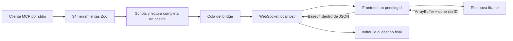

# Auditoría del MCP para creación de liveries

> Archivo histórico de la base `67057fc`. Los probes caracterizan defectos de esa base y no son pruebas de aceptación de 0.3.0. Las regresiones actuales están en `tests/`; los contratos y validación final, en `LIVERY_WORKFLOWS.md`. No ejecutar estos probes antiguos contra una sesión de usuario. La auditoría de dependencias adjunta corresponde a su fecha/base, no a un análisis vigente.

Fecha: 13-10-2026. Base auditada: `67057fc`, rama `codex/bridge-session-safety`, fork `r-bart/photopea-mcp-server`. Alcance: las 34 herramientas, constructor de scripts, frontend, bridge, archivos, dependencias y pruebas; contraste con nuestras sesiones iRacing y LMU. Es la primera auditoría completa.

## Conclusión

El primer arreglo de propiedad de pestañas es útil, pero el MCP todavía puede perder la correspondencia entre una orden, su resultado y el archivo guardado. Antes de automatizar más pasos de diseño hay que corregir ese contrato. Subir los timeouts o el límite de WebSocket no basta.

Tres hallazgos bloquean su uso como guardado fiable de los PSD de nuestro flujo:

1. Tras un timeout, la cola envía otra orden mientras Photopea puede seguir ejecutando la anterior; el frontend puede asignar su respuesta tardía a la orden nueva.
2. Una exportación puede aceptar texto, escribir `ok` en un `.psd` y anunciar éxito.
3. El límite de 100 MiB del mensaje WS, junto a base64/JSON, deja el PSD real en unos 75 MiB. Nuestro v17 está a solo 1,28 MiB del techo.

El [plan de implementación](../plans/2026-10-13_livery-mcp.md) propone un controlador de operaciones con estado, un transporte binario acotado y un guardado verificable, antes de añadir exportación de variantes y geometría de atlas.

## Evidencia y reproducción

| Evidencia | Resultado | Alcance |
|---|---|---|
| [Siete probes de cola/frontend](queue-probes/queue-behavior.test.ts) | Reproducen timeout antes del envío, atribución tardía, readiness incorrecto, promesa perdida y reenvío de operación activa | Código real del bridge y frontend con reloj virtual/DOM simulado; no intérprete Photopea |
| [Probes de exportación](export-probes/probe.ts) | `expectFiles` acepta texto; callback real persiste PSD falso de dos bytes; `done` sin binario devuelve éxito | Sintético, escritura en directorio de prueba |
| [Probe WebSocket](export-probes/ws-limit.mjs) | `WS_ERR_UNSUPPORTED_MESSAGE_LENGTH`, cierre 1009 | Socket localhost aislado y cabecera de frame grande; sin enviar 100 MiB |
| [Validación declarativa](synthetic-validation.ts) | Expresión inocua ejecutada mediante `list_fonts.search` y settings de filtro | VM con app falso, sin ejecución en Photopea |
| [Metadata de archivos](export-findings.md) | V17: 77.303.580 bytes; crecimiento v16→v17: 2.569.689 bytes | Solo tamaños; no se abrió ni modificó la biblioteca |
| [Auditoría npm](npm-audit.json) | 19 paquetes afectados: 10 producción / 9 desarrollo | Advisories actuales; alcance diferenciado en informe específico |

Los probes son **caracterizaciones del defecto**: pasar significa que lo reprodujeron, no que esté solucionado. La suite previa del fork tiene 60 pruebas correctas y un TODO de timeout; estas reproducciones no cambian ese código.

Comandos desde la raíz del fork:

```powershell
npx --no-install vitest run --config thoughts/audit/queue-probes/vitest.config.ts
node node_modules/tsx/dist/cli.mjs thoughts/audit/export-probes/probe.ts
node thoughts/audit/export-probes/ws-limit.mjs
node node_modules/tsx/dist/cli.mjs thoughts/audit/synthetic-validation.ts
node thoughts/audit/structural-metrics.mjs
```

La segunda prueba genera un archivo sintético inválido `false-success.psd`, excluido de Git. Ningún probe se conecta al puerto de la sesión de trabajo. No se exportó ni recargó el documento real v18.

## Arquitectura actual



Las herramientas mezclan lectura de archivos, selección implícita de documentos y varias solicitudes al bridge. La cola serializa mensajes individuales; no protege una operación completa de importar/pegar o cambiar visibilidad/exportar/restaurar. El frontend es quien asigna identidad a respuestas de Photopea que por sí mismas no llevan el ID MCP.

La [documentación oficial de Live Messaging](https://www.photopea.com/api/live), consultada el 13-10-2026, describe scripts o ArrayBuffer de entrada y `done` al completar; las exportaciones devuelven ArrayBuffer seguido de `done`. No documenta cancelación de una ejecución ni un ID de operación nativo. Esas garantías deben resolverse en el bridge y comprobarse con una prueba real.

## Hallazgos consolidados

La prioridad combina pérdida de trabajo, frecuencia en nuestra casuística y evidencia. «Reproducido» no significa «ocurrió en la sesión histórica».

| ID | Prioridad | Hallazgo y evidencia | Fuente |
|---|---|---|---|
| C1 | Crítica | El timeout empieza al encolar; al expirar la activa se despacha la siguiente y se puede confundir una respuesta tardía. También se acepta un ID de operación no enviada, reenviando la activa. Reproducido. | `websocket-server.ts:190-203,240-253,327-373`; `frontend/index.html:473-478,564-597` |
| C2 | Crítica | `expectFiles` no exige un archivo; cast sin validación y éxito con PSD de dos bytes. Reproducido. Un mensaje malformado puede eliminar el pendiente y su timer antes de fallar, dejando la promesa sin resolución. | `websocket-server.ts:339-363`; `tools/export.ts:28-39` |
| C3 | Crítica | PSD grande excede el límite de WS por base64. Umbral exacto 78.643.098 bytes para el sobre actual; cierre 1009 reproducido. | `websocket-server.ts:39`; `frontend/index.html:573-585,609-615`; ws instalado |
| M1 | Mayor | Escritura directa puede reemplazar un checkpoint anterior antes de verificar el nuevo. No hay staging, validación completa, hash ni política de reemplazo. Lectura de código; no se forzó fallo de disco real. | `utils/file-io.ts:12-17` |
| M2 | Mayor | `place_image` abre y copia/cierra/pega en dos solicitudes; destino implícito y sin exclusión de la operación. Riesgo estático de actuar sobre otro documento. | `tools/image.ts:49-89` |
| M3 | Mayor | Lectura de árbol anidado pero selectores raíz; above/below depende de activeLayer en vez de vecino del objetivo. Nombres repetidos y grupos comprometen nuestros decals/regiones. | `script-builder.ts:53-61,316-339,362-402` |
| M4 | Mayor | Reconexión WS borra readiness del iframe ya cargado; al reconectar no se anuncia listo. Cualquier mensaje puede marcarlo listo antes de `done`; status disconnected se ignora en servidor. Reproducido. | `frontend/index.html:320-332,411-430,532-554`; `websocket-server.ts:328-333` |
| M5 | Mayor | Fetch sin abort/tamaño y antes del timeout; colas con JSON/base64 completo y sin cuota. Copias completas y bucle por byte. Evidencia estática, heap real no medido. | `utils/file-io.ts:20-26`; `websocket-server.ts:228-257`; frontend |
| M6 | Mayor | Primer cliente WS no autenticado; sin comprobación de Origin/Host/path. Loopback reduce superficie, pero no identifica la pestaña legítima. | `websocket-server.ts:39-58` |
| M7 | Mayor | Entradas declarativas permiten inyectar expresiones en script: búsqueda de fuentes y ajustes numéricos. Reproducido en VM. Es ejecución Photopea, no RCE Node demostrada. | `tools/export.ts:74`; `tools/image.ts:102,119`; `script-builder.ts:558-625` |
| M8 | Mayor | Dependencias con avisos, especialmente ws directamente usado. Otros avisos transitivos no tienen ruta vulnerable demostrada aquí. | `package-lock.json`, [informe](security-architecture-findings.md) |
| M9 | Mayor | `place_image` posiciona bounds visibles; una máscara SVG de atlas necesita conservar el origen del lienzo. Código confirma semántica actual; desplazamiento exacto requiere prueba Photopea. | `tools/image.ts:65-86`; generadores SVG locales |
| D1 | Menor | Contratos imprecisos: shapes raster descritos como vectoriales, toda exportación descrita como aplanada, anotaciones destructivas incorrectas y versión MCP 0.1.0 frente a package 0.1.1. | tools, `server.ts:11` |
| D2 | Menor | Faltan CI y E2E real; `test:e2e` apunta a configuración ausente; tsc excluye tests; puerto fijo y sleeps. La prueba de desconexión no comprueba executeScript. | package, tsconfig, tests |

Fuentes completas con detalle: [exportación](export-findings.md), [arquitectura/seguridad](security-architecture-findings.md) y [casuística](livery-workflow-findings.md). No se ha añadido una segunda incidencia por cada consecuencia del mismo fallo.

## PSD v18: qué sabemos y qué no

Con el sobre JSON actual de 136 bytes, el máximo binario es `3 * floor((104857600 - 136) / 4) = 78.643.098` bytes. V17 mide 77.303.580: quedan 1.339.518 bytes, 1,27746 MiB. Si v18 hubiera crecido como la revisión anterior superaría ese techo, pero no tenemos su binario ni un registro del cierre.

El límite es un fallo real reproducido y muy relevante para este proyecto. La atribución histórica del fallo v18 sigue siendo hipótesis. Aumentar el límite permitiría pasar archivos algo mayores, pero conservaría base64, la multiplicación de buffers, los falsos éxitos y la cola defectuosa.

También importa el checkpoint: los PNG/TGA v18 existen, pero el generador SVG no reproduce los sponsors raster recolocados. Una recuperación solo del SVG no equivale a recuperar el PSD completo.

## Adaptación a nuestros casos

| Caso | Comportamiento que necesitamos |
|---|---|
| Recolocar wordmark y máscara en LMU | Documento/capas explícitos; operación compuesta; registrar bounds y resultados parciales |
| Albedo + Region + decal del alerón fuera del grupo | Receta de visibilidad validada antes de empezar; misma revisión; restauración verificada o pendiente explícita |
| PSD aprobado / variante nueva | Checkpoint versionado, validación, hash y reapertura por capas; original preservado |
| SVG 1600 de diseño → 4096 de atlas | Separar escala de lienzo y bounds del contenido; conservar margen transparente y origen |
| Doble pestaña, reconexión o timeout | Identidad de sesión y operación; nunca repetir paste/move/duplicate automáticamente |
| Limpiar color/halo | Máscara acotada, alfa conservado y comparación por región; análisis fuera del editor |
| Marca persistente solo en el juego | La skill diagnostica spec/decal/región/caché; el MCP no tapa repetidamente el albedo |

Las coordenadas M4, colores LMU, años de template, IDs y rutas del usuario pertenecen a las skills/atlas. Conversión TGA, instalación con backups y validación en el simulador siguen en `sim-livery-tools`. El MCP debe ofrecer primitivas verificables que esos procedimientos puedan componer.

## Métricas y cobertura

13 archivos de producción, 34 herramientas. `script-builder.ts` tiene 847 líneas, frontend 645 contando HTML/CSS, bridge 391. Hay duplicación del ciclo de timeout/cola entre loadFile y executeScript y conversión de bounds dispersa; conviene extraer responsabilidades donde eliminan esos defectos.

[Medición AST reproducible](structural-metrics.json): 126 funciones/métodos/callbacks TS. Aproximación de ramas, excluyendo funciones anidadas y JavaScript dentro de HTML:

| Función | Ramas aproximadas | Líneas |
|---|---:|---:|
| Callback place_image | 19 | 60 |
| buildApplyAdjustment | 17 | 44 |
| handleClientMessage | 14 | 41 |
| buildApplyFilter | 13 | 40 |
| buildAddText | 10 | 58 |
| Callback open_file | 10 | 28 |
| processNext | 8 | 55 |

No es una medición canónica de complejidad cognitiva/ciclomática ni prueba de error. No hay informe de cobertura: no se inventa porcentaje ni se penaliza su ausencia como si fuera 0%. Los tests de generación de scripts comprueban principalmente cadenas; no prueban el efecto en Photopea.

Resumen heurístico de la skill audit: 3 críticas, 9 mayores, 2 menores; score `100 - 3*15 - 9*5 - 2 = 8/100` (requiere atención crítica en integridad). Deuda nominal `3*4h + 9*1h + 2*0,25h = 21,5h`, nivel moderado según su fórmula. **Estas fórmulas no son una estimación del calendario de implementación**: no miden pruebas reales de Photopea, alcance nuevo ni dificultad del transporte. Sin penalización adicional de complejidad/cobertura y sin tendencia previa.

## Decisión recomendada

Resolver C1/C2 junto con M1/M2 antes de ampliar herramientas; reemplazar el transporte para C3; probar checkpoint PSD y receta LMU en documentos independientes. Después añadir geometría y recolores que reduzcan scripts manuales. La configuración MCP del usuario sigue apuntando a la instalación anterior; el plan incluye migración con recuperación y rollback.
