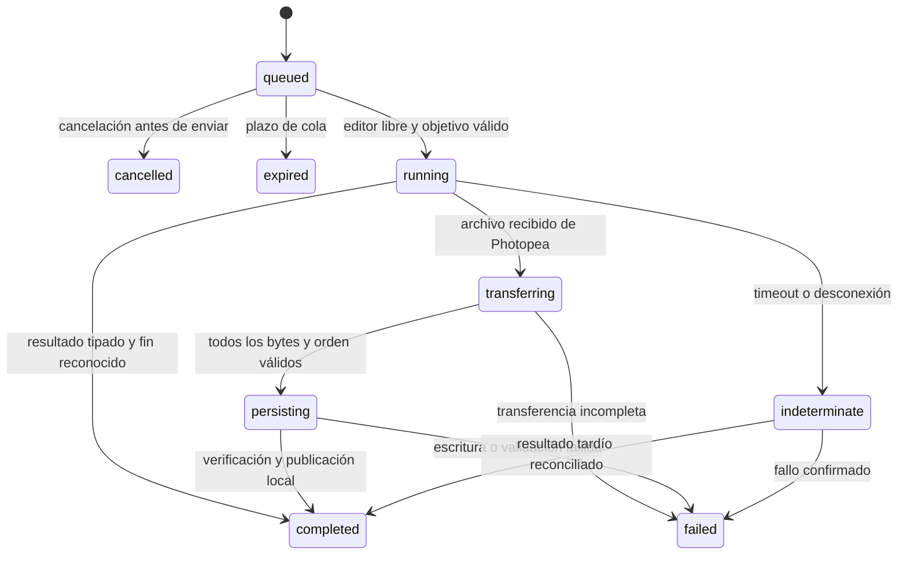

# Plan: MCP Photopea fiable para liveries

> Cierre de alcance acordado, 14-10-2026: PR #1–#3 integradas en `main`, paquete 0.3.0 instalado/verificado y cinco skills instaladas. Los cuatro bloques solicitados tras el hito PSD están implementados y comprobados; ver `LIVERY_WORKFLOWS.md`. Este documento conserva la propuesta original, no una afirmación de que todas sus ideas futuras estén entregadas. Recolor acotado, previews/diffs dedicados y extensión de todos los adapters legacy a referencias explícitas siguen fuera de esos cuatro bloques. El refresco del catálogo MCP actual requiere el control de conexión de Codex; no se ha reiniciado la app ni la sesión legacy.

Fecha: 13-10-2026. Estado: propuesto, basado en auditoría y reproducciones sobre `67057fc`. El arreglo de segunda pestaña está en la PR #1; este documento define las siguientes entregas. No marca sus tareas como implementadas.

## Resultado buscado

Poder editar capas de un coche identificado, guardar un PSD recuperable y exportar las composiciones de pintura/materiales de esa revisión. Ante un timeout o desconexión, distinguir ejecución confirmada, no iniciada e indeterminada, y comprobar qué archivos quedaron guardados.

El primer hito será un **checkpoint PSD de más de 80 MiB que se exporta, verifica y reabre conservando capas**, con fallos inyectados que dejan intacta la revisión anterior. El segundo será una exportación LMU albedo/regiones coherente y con visibilidad restaurada. La colocación de SVG y recolores viene después.

## Requisitos concretos

- Una sola operación activa en cada editor y exclusión durante operaciones compuestas.
- ID estable de operación mientras se espera, ejecuta, transfiere y escribe. Reintentar una consulta no repite una mutación.
- Timeout de espera separado del estado del motor: expirar no significa cancelar Photopea.
- Nunca aceptar texto, archivo vacío, otro formato o respuesta de otra operación como PSD guardado.
- Preservar el checkpoint anterior ante desconexión, archivo bloqueado, disco lleno o fallo de validación.
- Transporte de archivos grandes sin base64/JSON completo, con límites y control de flujo.
- Referencias explícitas a documento y capas anidadas; nombres duplicados requieren resolución, no elección arbitraria.
- Paquetes de exportación con manifiesto final y estados separados de instalación, revisión 3D y publicación.
- Mantener datos del simulador y atlas en skills; no incorporar coordenadas/IDs personales en el servidor.
- Migración a Windows verificada sin usar como fixture el único documento con v18 sin guardar.

## Enfoques considerados

| Opción | Ventaja | Límite | Decisión |
|---|---|---|---|
| A. Aumentar timeouts/maxPayload y añadir comprobaciones puntuales | Cambio corto, útil como diagnóstico acotado | Conserva correlación defectuosa, memoria base64, operaciones compuestas y falta de recuperación | No usar como solución final |
| B. Controlador de operaciones + canal binario + servicio de artefactos | Resuelve integridad y sirve tanto a PSD como a nuestros flujos compuestos | Cambia protocolo y exige pruebas de fallo e integración real | Recomendada |
| C. Reescribir toda la aplicación o crear un editor especializado por simulador | Libertad de diseño | Aumenta alcance, duplica Photopea y las skills antes de resolver lo fundamental | Fuera de esta etapa |

Para B, usar mensajes de control JSON pequeños y chunks binarios sobre el WS existente. Un upload HTTP con token también sería viable, pero añade otra superficie de autenticación/recuperación. Elegir una vía y medirla; no mantener ambas para el mismo archivo.

La API de Photopea entrega un ArrayBuffer completo: el bridge puede eliminar copias/base64 y transmitir por partes, pero **no promete streaming dentro del serializador de Photopea** ni progreso porcentual de esa fase.

## Modelo de operación y sesión

Cada operación tendrá `operationId`, `sessionId`, `connectionEpoch`, tipo, objetivo, fase, marcas de tiempo, presupuesto y resultado discriminado. El cliente del bridge solo podrá completar la operación activa de la sesión/generación autorizada. Validar el mensaje completo antes de tocar la cola o sus timers.



`indeterminate` conserva la propiedad del editor: la siguiente mutación no sale hasta reconciliar la operación. Si el cliente MCP deja de esperar, el trabajo puede seguir; el resultado tardío conserva su ID y se consulta por él. La cancelación después del envío solo puede detener espera o IO cancelable: no afirmar que deshizo o interrumpió Photopea.

Una desconexión durante transferencia no demuestra que el editor esté libre: registrar por separado estado del artefacto y estado del editor. El carril de ejecución permanece retenido si falta confirmar el final de Photopea, incluso si la transferencia ya se marcó fallida.

Encapsular scripts generados con mensajes de inicio/fin identificados usando `echoToOE`, capturar errores estructurados y esperar el cierre real de la operación. `done` y ArrayBuffer no llevan ID nativo: la correlación requiere exclusión, sesión y validación del protocolo, no basta añadir un UUID al mensaje WS. Probar orden de eventos de errores de sintaxis, scripts, carga binaria y `saveToOE` antes de fijar el adaptador. Scripts arbitrarios con operaciones asíncronas no verificables deben producir un estado explícito y no liberar la cola por una heurística de texto.

En una sesión distinta nunca reenviar operaciones pendientes. Si reinicia el servidor, recuperar el diario como estado desconocido, no como cola para reproducir. La interfaz conserva una recuperación manual del documento; no recarga el iframe para resolver automáticamente un timeout.

## Contratos propuestos

Conservar las herramientas actuales como adaptadores; ampliar solo lo necesario. Los nombres nuevos son propuestas de API, todavía no herramientas disponibles.

| Capacidad | Contrato propuesto |
|---|---|
| Estado | `photopea_get_status()` → versión/protocolo, sesión, editor listo, operación activa, cola y fase; no crea una pestaña como efecto secundario |
| Documentos | `photopea_list_documents()` → referencias de sesión, nombre, dimensiones, modo y activo; guardar procedencia original |
| Capas | `photopea_get_layers({document, parent?, depth?})` → selectores reutilizables, padre, propiedades reales, bounds finitos y visibilidad efectiva |
| Operaciones largas | `photopea_export_artifacts({...})` → `operationId` inmediato; `photopea_get_operation({operationId, waitMs?})` con espera acotada y resultado durable |
| Cancelación | `photopea_cancel_operation({operationId})` → `cancelled_before_dispatch`, `io_cancelled` o `execution_not_cancellable`; nunca éxito ficticio |
| Checkpoint | Modalidad de `export_artifacts` con PSD, revisión nueva y política `create_new` por defecto; devolver grados de validación |
| Importar | Extender `place_image` con `document`, origen `canvas/content_bounds`, política de escala y objetivo explícito |
| Ordenar | Destino explícito `{target, relativeTo, placement}` y postcondición padre/posición; conservar adapter para la API antigua con semántica corregida |

`documentRef` será válido solo dentro de sesión/generación. La [API documenta `Document.source`](https://www.photopea.com/learn/scripts); usarlo como marcador solo si el ensayo acredita que no altera comportamiento de guardado/procedencia. Guardar su valor original en metadata no acredita por sí solo esa compatibilidad. Si no se demuestra, resolver conservadoramente y rechazar ambigüedad. No asumir IDs nativos de capa/documento ni variables globales persistentes sin probarlo.

Para capas: preferir IDs estables si el ensayo demuestra soporte; alternativa explícita es ruta de grupos/nombre/ordinal con comprobación de estructura. Si solo hay selectores estructurales, llamarlos selectores y no prometer identidad estable. Invalidar snapshots tras cambios de jerarquía y scripts arbitrarios; ante ambigüedad devolver error antes de mutar. Los cambios manuales de píxeles no se detectan necesariamente por nombre/bounds: un contador del bridge solo registra cambios propios.

Resultado de artefacto mínimo:

```typescript
type ArtifactResult = {
  operationId: string;
  documentRef: string;
  revision: string;
  path: string;
  format: 'psd' | 'png' | 'jpg' | 'webp' | 'svg';
  byteLength: number;
  sha256: string;
  width?: number;
  height?: number;
  validation: 'structure_checked' | 'decoded' | 'reopened_layers_checked';
};
```

La firma PSD y un hash no demuestran integridad de todas las capas. El resultado distingue archivo persistido, validación estructural, decodificación y reapertura. No inventar dimensiones verificadas para un formato que el validador no compruebe.

## Fases y tareas

### Fase 0 — Convertir la auditoría en criterios ejecutables

**Tarea 0.1 — Fixtures y observación.** Convertir los probes de `thoughts/audit` en pruebas de comportamiento esperado bajo `tests/`; mantener evidencia del fallo de la base. Reloj inyectable y puertos efímeros. Cubrir estados y errores, no snapshots de frases. No hay manifiesto de spec tests previo.

**Tarea 0.2 — Ensayo pequeño en Photopea aislado.** Iniciar el fork en otro puerto y usar un documento sintético con grupos, capas ocultas, ajuste Levels, raster con alfa, texto y SVG desplazado. Medir orden de mensajes, errores, identidad, bounds y guardado/reapertura. Registrar versión/fecha, tamaños y capturas. La sesión de trabajo existente no es fixture. Este ensayo resuelve la elección del adaptador de IDs y el contrato de terminación.

**Aceptación:** pruebas especificadas para cada hallazgo C1–C3/M1–M9; protocolo observado documentado; limitaciones del intérprete registradas. Si una API no funciona, actualizar el diseño de esa capacidad antes de implementarla.

### Fase 1 — Propiedad de operación, timeouts y reconexión

**Tarea 1.1 — Cola de operaciones.** Extraer `OperationManager` y `EditorSession`; serializar operaciones completas, no cada llamada interna. Proporcionar exclusión para todos los pasos de `place_image`; la captura y validación de destino/auxiliar se implementa en 3.2. Usar un contexto interno para ejecutar pasos bajo el mismo propietario sin reencolarlos ni bloquearse a sí mismo.

**Tarea 1.2 — Presupuestos y recuperación.** Plazos separados para cola, readiness, ejecución, transferencia sin avance y persistencia. El plazo de ejecución empieza al enviar; una cola expirada es `not_started`. Timeout activo es `indeterminate`; retener el carril y asociar resultados tardíos al ID original. Cola acotada, consultas de estado y cancelación honesta. Diario ligero de operaciones/artefactos, sin contenido del PSD ni scripts secretos. No replay automático tras restart.

**Tarea 1.3 — Handshake y mensajes.** Protocolo versionado, esquema discriminado y session/epoch/active-operation obligatorios. Corregir reconexión del iframe ya cargado y exigir `done`/handshake observado, no cualquier mensaje. Rechazar archivos/textos incorrectos, IDs de cola no enviados y mensajes duplicados/tardíos sin alterar otra operación. Cada promise debe terminar o quedar consultable como estado indeterminado, nunca perderse.

Presupuestos iniciales propuestos para medir, no límites certificados: cola 120 s, script ordinario 30 s configurable por tipo, serialización PSD 180 s, ausencia de progreso de transferencia 30 s. Las operaciones largas devuelven un ID inmediatamente; consultas esperan como máximo 25 s. Un heartbeat del puente no reinicia indefinidamente el tiempo máximo de ejecución ni se presenta como progreso de Photopea.

**Aceptación:** A tarda 45 s y B llega después: B no consume su presupuesto de ejecución en cola. Si A expira, B no se envía; resultado tardío de A conserva su ID. Cancelar espera MCP no duplica pegados. Desconexión/reconexión mantiene el documento sin recargar y explica el estado. Mensaje inválido no libera la cola ni pierde la promesa. Stop limpia todos los timers/esperas.

### Fase 2 — Artefactos grandes y checkpoints recuperables

**Tarea 2.1 — Transporte binario.** Mensajes `file_begin/chunk/file_end`, transferId unido a operación/sesión, secuencia/offset, longitud total y formato. Chunks iniciales de 1 MiB, ventana de 4 MiB con ACK/backpressure, total configurable de 512 MiB para comenzar las pruebas. Son parámetros de diseño, no promesa de que todo documento de ese tamaño serialice en el navegador. Ningún chunk supera el límite configurado; control JSON y total se acotan por separado.

Transferir directamente vistas/slices del ArrayBuffer sin bucle por byte ni base64; liberar referencias al terminar. El backend escribe a temporal incrementalmente y calcula hash. Para carga, leer por flujo y reconstruir un ArrayBuffer antes de enviar a Photopea, con preflight de tamaño y cuota de memoria/concurrencia. No retener varios PSD completos en la cola: encolar referencias preparadas, abrir/transferir cuando corresponda.

Comparar un SHA-256 calculado sobre los bytes originales en el emisor con el del receptor y archivo persistido. Un hash solo en backend no prueba integridad de extremo a extremo. Medir coste y memoria del hashing en navegador; no asumir que `subtle.digest` sobre el buffer completo evita copias. En fixtures sintéticos, el checksum esperado procede de la fuente independiente.

**Tarea 2.2 — Persistencia y validación.** Temporal en el volumen del destino, validación de longitud/formato/estructura, hash y promoción solo al completar. Default ruta nueva versionada; reemplazo solicitado con backup y recuperación probada en Windows. Verificar existencia y lectura del archivo promovido. PNG decodificable e IHDR correcto; PSD cabecera y longitudes internas válidas mediante parser soportado o lectura estructural acotada. Elegir librería tras probar el fixture Photopea, especialmente ajustes y smart objects. No aceptar solo magic bytes como PSD completo.

La promoción es el punto de commit. Registrar intención antes y reconciliar ruta/tamaño/hash si falla el diario o la respuesta después. Tras publicar el archivo, una cancelación no puede devolver `io_cancelled` como si no existiera: devolver el resultado reconciliado o persistencia indeterminada hasta verificarlo. Probar caída justo antes y después de la promoción.

**Tarea 2.3 — Checkpoint.** Guardar el PSD de la revisión de edición antes de variantes. Reabrir una copia aislada en la prueba de aceptación y comparar árbol/visibilidades/dimensiones y compuesto de referencia. Marcar el grado de verificación; no confundir cierre `save:true` con archivo guardado en ruta controlada. El resultado de una escritura que termina después del timeout del cliente sigue disponible por operationId.

La opción oficial `psd:true` produce PSD minificado; evaluarla más adelante como opción explícita con roundtrip comprobado. No usarla como sustituto del arreglo del transporte ni cambiar el formato del master silenciosamente.

**Aceptación:** hash idéntico en transferencia sintética a ambos lados del antiguo límite y con 80/150/300 MiB; interrupción en cualquier chunk, secuencia duplicada/ausente, tamaño falso, disco fallido y archivo bloqueado. El checkpoint anterior conserva su hash. PSD real sintético >80 MiB reabierto con capas y ajuste conservados. Medir RSS Node, memoria del navegador cuando se pueda y tiempo por fase; registrar datos en vez de fijar mejoras porcentuales inventadas.

### Fase 3 — Objetivos precisos, composición y SVG

**Tarea 3.1 — Referencias y selectores.** Implementar list_documents y document explícito; get_layers con árbol/selector/parent/bounds finitos, consultas de subárbol para no devolver atlas completos innecesariamente. Referencias de otra sesión, ambigüedades y cambios detectables del snapshot fallan. Un selector estructural no detecta sustituir una capa por otra indistinguible; documentar y probar ese límite. Corregir reordenación y devolver jerarquía posterior. Centralizar conversión numérica sin fallback silencioso a cero. Esta tarea precede al checkpoint 2.3 aunque se agrupe aquí por área.

**Tarea 3.2 — Importación compuesta.** Capturar destino antes de abrir fuente, identificar auxiliar creado, copiar/pegar hacia destino explícito y cerrar solo ese auxiliar. Validar precondiciones entre fases y reportar estado parcial si se perdió certeza. Exclusión MCP no bloquea al usuario en la UI: comprobar identidad antes de cada fase y documentar ese límite.

**Tarea 3.3 — Origen SVG y transformación.** Separar `canvas` de `content_bounds`. Conservar origen y escala del SVG 1600→4096 aunque su única pieza esté lejos de (0,0). Añadir posición absoluta/centro y postcondición de bounds a transforms; evitar reintentos de movimientos relativos. Parejas logo/máscara pueden agruparse bajo una operación con resultado por paso; no prometer rollback universal mediante undo.

**Aceptación:** dos documentos con mismo nombre; Region 0 repetido en grupos; tres niveles; cambiar activo entre carga y pegado; SVG con márgenes transparentes y pieza pequeña; alfa completamente vacío; rotación 90° y posición conocida; reordenar respecto a sí misma devuelve no-op/error claro. Ningún documento auxiliar se cierra por nombre ambiguo.

### Fase 4 — Exportar una revisión de livery como conjunto

**Tarea 4.1 — Recetas de visibilidad.** Añadir outputs a export_artifacts con lista explícita de visibilidades por selector. Preferir una copia de trabajo aislada abierta desde el checkpoint durable para generar todas las variantes; validar viabilidad y presupuesto de memoria con el PSD grande. Resolver selectores en esa copia, sin reutilizar referencias de la sesión original. Capturar solo propiedades legibles y verificables: visibilidad propia, grupos afectados y documento/capa activos si el ensayo los soporta. Aplicar receta → exportar a directorio de revisión → validar cada archivo → restaurar y comprobar. Restaurar visibilidad no promete restaurar selección, historial, modified flag ni ediciones manuales.

La exclusión MCP no bloquea la UI. Declarar una ventana cooperativa sin edición manual de la copia de exportación; registrar `consistencyMode` y hash del checkpoint. Si no es viable la copia, el modo sobre documento vivo requiere explícitamente esa misma condición y no certifica identidad de píxeles entre outputs. La edición manual detectable invalida el conjunto; cambios de píxeles indetectables no pueden excluirse mediante nombres/bounds o un contador del bridge. No presentar ninguno de estos modos como aislamiento absoluto de la UI.

**Tarea 4.2 — Manifiesto de conjunto.** Relacionar checkpoint, documento, revisión, recetas, archivos, hashes y etapas. Publicar manifiesto `complete` solo cuando todos los outputs y la restauración estén comprobados; si falla una pieza o restauración, manifest `incomplete` con resultados parciales y plan de recuperación. Varios archivos no se renombrarán como si fueran una transacción atómica del filesystem: usar un directorio nuevo por revisión y manifiesto final como señal de disponibilidad.

**Tarea 4.3 — Conectar con skills.** Actualizar `livery-photopea` para estado/checkpoint/errores y las recetas de iRacing/LMU para usar las herramientas nuevas. Conservar TGA y instalación en `texture_files.py`. Añadir lectura de manifiesto que rechace conjuntos incompletos si se usa ese flujo; probar rechazo y match de hashes. Un bundle completo no equivale a validación en el coche ni a publicación.

Fixture LMU: cuerpo, Levels, Carbon, Region, Region 0, máscara blanca del alerón en raíz, Mask/Wire/Display Panel Position. Albedo conserva ajuste visual; regiones conserva clases de material según receta; guías fuera de ambos. No aplicar reglas de visibilidad universales a templates diferentes.

**Aceptación:** segundo export falla sin invalidar el checkpoint ni la revisión anterior; restauración queda verificada o pendiente con selectores/estado original. El conjunto no queda listo para instalar si falta archivo, hash o restauración. Los PNG se comparan con fixture de referencia y albedo/decal coinciden geométricamente. Ensayar edición manual entre outputs: cambios en el original no afectan a la copia; intervención detectable en la copia deja `incomplete`. El manifiesto declara la condición cooperativa y no asegura detectar toda edición manual.

### Fase 5 — Reducir trabajo manual de diseño

**Tarea 5.1 — Recolor acotado.** Operación que conserve alfa y restrinja el cambio por selección/máscara; esquemas tipados para números, colores y polígonos. Comparar solo región declarada. Conservar análisis de proximidad/halos y generación de máscaras en Python/SVG.

**Tarea 5.2 — Inspección útil.** Previews recortadas con escala/origen, diff acotado y bounds antes/después. La cuadrícula UV numerada se genera fuera; el MCP la importa como capa identificada y la excluye mediante receta. No adivinar lados del coche, simetría ni material a partir del atlas.

**Aceptación:** antialias y alfa idénticos fuera de la máscara; sponsor del mismo color fuera de región intacto; texto conserva proporciones/lectura; guía de diagnóstico ausente de outputs. Validación en 3D se registra por vista y revisión en la skill.

### Línea transversal — Seguridad, compatibilidad y calidad

**Tarea S.1 — Entrada al bridge.** Token efímero por arranque y origen/host/path esperado; autenticar antes de adjudicar propiedad de sesión. Bootstrap propuesto: token en fragmento de la URL de lanzamiento, sin imprimirlo, pasado al handshake y retirado de la barra mediante history API; jamás devolverlo en HTML accesible sin credencial ni incluirlo en manifiestos. El token no se envía al iframe. Comprobar reautenticación sin recargar el editor. Esto protege frente a conexiones accidentales y otros orígenes; no promete aislamiento frente a procesos hostiles con los mismos permisos del usuario. Mantener loopback.

**Tarea S.2 — Contratos y dependencias.** Serializar literales con una única función, settings por unión discriminada, rangos y números finitos; corregir anotaciones y descripciones de las 34 herramientas. Actualizar ws primero con regresiones de protocolo; SDK y toolchain en cambios separados y lock revisado. Distinguir advisories alcanzables de transitivos; no aplicar audit fix --force. Unificar versión real/handshake/MCP y metadata del fork manteniendo autoría/licencia upstream.

**Tarea S.3 — CI.** Typecheck de src y tests, unit/integration en Windows y Linux con versión Node mantenida elegida según las dependencias verificadas, fixtures de protocolo sin navegador ni assets privados, y gate manual documentado para Photopea real. Coverage por ramas del controlador de operaciones como evidencia auxiliar; no exigir porcentaje global decorativo. Sustituir script E2E inexistente por uno real o eliminarlo hasta disponer del harness. Logs con operación/fase/bytes/duración/error; sin PSD, tokens ni queries firmadas.

## Archivos previstos

| Área | Crear/modificar | Motivo |
|---|---|---|
| Operaciones | `src/bridge/operation-manager.ts`, `session.ts`, `types.ts`, `websocket-server.ts` | Estados, exclusión, deadlines, correlación y recuperación |
| Frontend | Extraer controlador de `src/frontend/index.html` a módulo testeable; actualizar servidor estático/build | Protocolo/versiones, readiness, propietario y estado visible |
| Archivos | `src/bridge/file-transfer.ts`, `src/utils/artifacts.ts`, `file-io.ts` | Chunks, staging, límites, hash y validación |
| Herramientas | `src/tools/export.ts`, `document.ts`, `layer.ts`, `image.ts`, `server.ts` | Adaptadores compatibles, operación larga y referencias |
| Scripts | Dividir `script-builder.ts` por familias según cambios | Serialización común, números/objetivos y scripts verificables |
| Pruebas | `tests/unit/operations*`, `tests/integration/protocol*`, `tests/integration/artifacts*`, harness E2E real | Reproducciones como regresiones y fallos inyectados |
| Entorno | package/lock, configs TS/Vitest y `.github/workflows/ci.yml` | Versiones coherentes y validación multiplataforma |
| Skills | Repo hermano: tres skills, perfiles por template y utilidades de manifiesto | Consumir garantías genéricas sin duplicar lógica de transporte |

Los nombres de módulos son una propuesta; preservar estructura upstream cuando no obstaculice la corrección. No se requiere framework de UI ni servicio remoto.

## Dependencias y entregas revisables

```yaml
dependencies:
  "0.1": []
  "0.2": ["0.1"]
  "1.1": ["0.1"]
  "1.2": ["1.1"]
  "1.3": ["1.1", "0.2"]
  "2.1": ["1.2", "1.3"]
  "2.2": ["1.3"]
  "2.3": ["2.1", "2.2", "0.2", "3.1"]
  "3.1": ["1.1", "0.2"]
  "3.2": ["3.1", "1.2", "1.3"]
  "3.3": ["3.2"]
  "4.1": ["2.3", "3.1"]
  "4.2": ["4.1", "2.2"]
  "4.3": ["4.2"]
  "5.1": ["3.3", "S.2"]
  "5.2": ["4.3", "3.3"]
  "S.1": ["1.3"]
  "S.2": ["0.1"]
  "S.3": ["0.1"]
```

Orden de entregas recomendado: PR #1 existente → operaciones/cola → contrato de archivos y persistencia → referencias de documento/capas → transporte/checkpoint grande → importaciones → bundles → diseño acotado. S.2/S.3 pueden avanzar junto a operaciones; S.1 se integra con el nuevo handshake. No activar el fork de trabajo hasta completar el hito PSD, objetivos/operaciones compuestas, S.1–S.3 y la prueba real de migración.

## Migración y cierre

1. Identificar versión/proceso/puerto actuales y guardar la configuración anterior. No deducir que el paquete instalado coincide solo porque ambos dicen 0.1.1; hay archivos de workflows antiguos no registrados en el servidor instalado.
2. Preservar trabajo abierto de la sesión actual con un archivo durable comprobado antes de recargar/cerrar. Si no puede guardarse, conservar esa sesión y ensayar el fork por separado; nunca usar un reset como solución automática.
3. Ejecutar la matriz sintética, un PSD independiente >80 MiB y un bundle LMU de prueba. Comprobar archivo reabierto, capas, tiempos, memoria y recuperación.
4. Configurar el fork con ruta/version fijadas y backup de config. Mantener la ruta anterior como rollback. Probar descubrimiento de tools/versión, carga, modificación, guardado y reapertura en documento desechable; después usar copia de template.
5. Actualizar skills instaladas desde su repositorio y registrar qué versión de protocolo soportan. Las fuentes aprobadas y publicaciones no cambian por la migración.

Done del primer hito: C1/C2/C3 dejan de reproducirse bajo pruebas de corrección; un timeout no dispara una mutación distinta; un PSD válido >80 MiB atraviesa el protocolo y se reabre con capas; un fallo conserva el checkpoint anterior; errores informan fase y estado real. Done del segundo: bundle completo y restaurado o incompleto explícito, nunca listo ficticio. Revisión posterior de los cambios antes de activar en el flujo habitual.

La [auditoría](../audit/2026-10-13_audit.md) y sus probes son la evidencia inicial. API consultada: [Live Messaging](https://www.photopea.com/api/live) y [Scripts](https://www.photopea.com/learn/scripts). Las propiedades y restricciones no documentadas quedan como aceptación del ensayo real, no como garantías asumidas.
